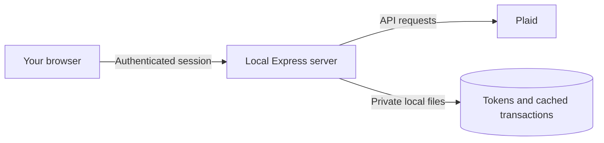

# Spend

A private, local-first personal finance dashboard for tracking spending, savings, and investments through [Plaid](https://plaid.com/).

Spend runs on your own computer. It groups transactions by category, compares connected accounts, tracks monthly activity, and displays balances without sending Plaid access tokens to the browser.

> [!IMPORTANT]
> Spend is a self-hosted, single-user project—not a hosted financial service. Start with Plaid Sandbox. Do not expose the server directly to the public internet.

## Features

- Monthly spending totals and category breakdowns
- Combined and per-account views
- Recent transaction activity
- Manual transaction category overrides
- Savings and investment account tracking
- Brokerage transaction and portfolio balance support
- Local transaction caching for faster historical views
- Password-protected, rate-limited sessions
- Server-side Plaid token storage
- Sandbox, Development, and Production Plaid environments

## How it works



Plaid credentials and access tokens remain on the server. The browser receives only connected account names and financial data needed for the dashboard.

## Requirements

- [Node.js](https://nodejs.org/) 20 or newer
- npm
- A [Plaid developer account](https://dashboard.plaid.com/signup)

## Quick start

### 1. Clone and install

Clone this repository using the **Code** button on GitHub, then open a terminal in the project directory:

```bash
npm install
```

### 2. Configure the environment

Copy the example file:

```bash
cp .env.example .env
```

Generate a session secret:

```bash
openssl rand -hex 32
```

Open `.env` and configure:

```dotenv
PLAID_CLIENT_ID=your_plaid_client_id
PLAID_SECRET=your_plaid_sandbox_secret
PLAID_ENV=sandbox
APP_PASSWORD=choose_a_long_unique_password
SESSION_SECRET=paste_the_generated_value_here
PORT=3000
HOST=127.0.0.1
```

`SESSION_SECRET` signs session cookies so they cannot be forged or modified. It does not preserve logins after a restart: this local app intentionally stores active sessions in memory, so restarting the server requires signing in again.

Plaid credentials are available under **Team Settings → Keys** in the Plaid dashboard.

### 3. Start Spend

```bash
npm start
```

Open [http://127.0.0.1:3000](http://127.0.0.1:3000) and sign in with `APP_PASSWORD`.

### 4. Connect a Sandbox account

Plaid Sandbox uses simulated financial data. In Plaid Link, use:

- Username: `user_good`
- Password: `pass_good`

No real bank account is involved in Sandbox mode.

## Using real financial accounts

Plaid controls access to live financial data. Before switching environments, review its current [application and access requirements](https://plaid.com/docs/quickstart/#api-access).

When approved, update `.env` with the matching secret and environment:

```dotenv
PLAID_SECRET=your_matching_environment_secret
PLAID_ENV=development
```

Use `PLAID_ENV=production` only with a Production secret. Restart the server after any environment change. Tokens created in one Plaid environment cannot be used in another.

## Local data and privacy

Spend creates these private local files at runtime:

| Path | Contents |
|---|---|
| `tokens.json` | Plaid access tokens and account types |
| `data/transactions-YYYY-MM.json` | Cached transaction data |
| `data/category-overrides.json` | Manual category choices |

These paths and `.env` are excluded by `.gitignore`. They must never be committed, uploaded, or shared. The server attempts to set JSON files to owner-only permissions (`0600`).

The files are not encrypted at rest. Anyone who can access your operating-system account may be able to read them. Use full-disk encryption and a protected user account when working with real financial data.

To reset all connected accounts and cached data, stop the server and delete `tokens.json` and `data/`. This removes local data only; revoke Items separately in Plaid if needed.

## Security model

The application includes:

- HTTP-only, same-site session cookies
- Login rate limiting
- Timing-safe password comparison
- Authentication on all financial endpoints
- Plaid access tokens kept out of browser storage
- Same-origin browser requests; permissive CORS is disabled
- Request size and input validation
- Common HTTP security headers through Helmet
- Loopback-only binding by default

### Deployment warning

The default configuration is intentionally local-only. It uses an in-memory session store and plain local JSON storage. Do not expose it directly to the internet or set `HOST=0.0.0.0` without adding, at minimum:

- HTTPS through a trusted reverse proxy
- A persistent production session store
- Encrypted secret and data storage
- CSRF protection and a strict Content Security Policy
- Backups, monitoring, and a multi-user authorization design

## Useful commands

```bash
npm start          # Run the application
npm run check      # Check backend JavaScript syntax
npm audit          # Check dependencies for known vulnerabilities
```

## Troubleshooting

### The server reports missing environment variables

Confirm `.env` exists and contains `PLAID_CLIENT_ID`, `PLAID_SECRET`, and `APP_PASSWORD`.

### Plaid reports an invalid secret or environment

Ensure `PLAID_SECRET` belongs to the environment selected by `PLAID_ENV`.

### `NO_INVESTMENT_ACCOUNTS`

The connected Plaid Item has no brokerage accounts. Spend automatically falls back to regular transactions so savings accounts can still appear under **Savings & Investments**.

### Port 3000 is already in use

Change `PORT` in `.env`, restart the server, and open the new local URL.

### Sessions reset after every restart

This is expected. Active sessions are held in memory and are erased when the server stops. `SESSION_SECRET` protects cookie integrity but does not store session records. Persistent login would require a persistent session store, which is intentionally not part of the local-only default.

## Project structure

```text
.
├── index.html        # Dashboard UI
├── server.js         # Express and Plaid backend
├── .env.example      # Safe configuration template
├── package.json      # Scripts and dependencies
└── data/             # Runtime cache; created locally and ignored
```

## Contributing

Issues and pull requests are welcome. Please:

1. Never include real credentials, access tokens, or transaction data.
2. Test changes with Plaid Sandbox.
3. Run `npm run check` and `npm audit` before submitting.
4. Keep the project local-first and single-user unless a change explicitly redesigns the security model.

## Disclaimer

This project is for personal informational use and is not financial, investment, tax, or legal advice. Plaid is a trademark of Plaid Inc.; this project is not affiliated with or endorsed by Plaid.

## License

Released under the [MIT License](LICENSE).
